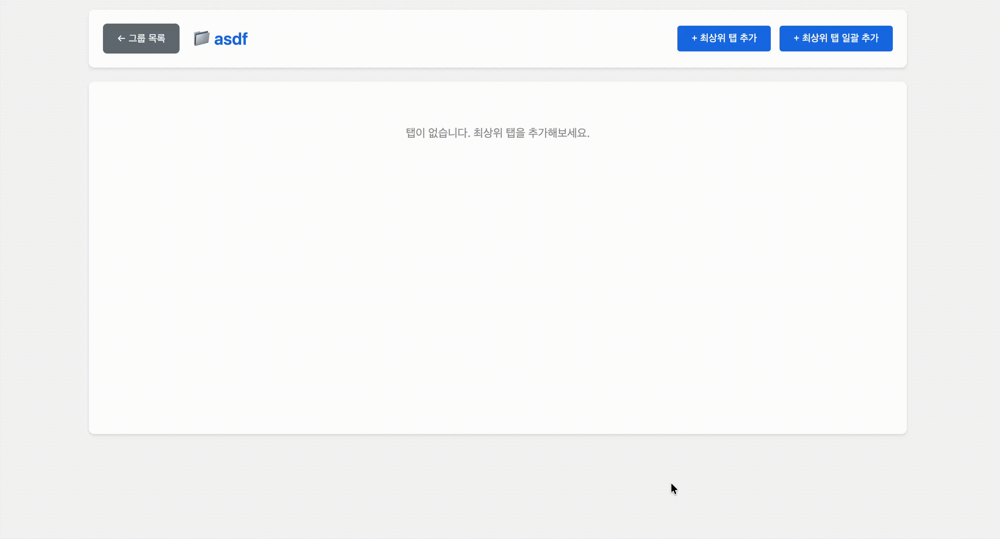
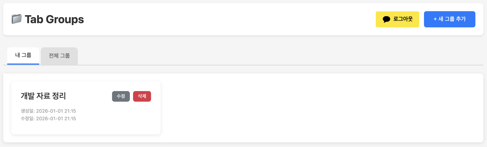
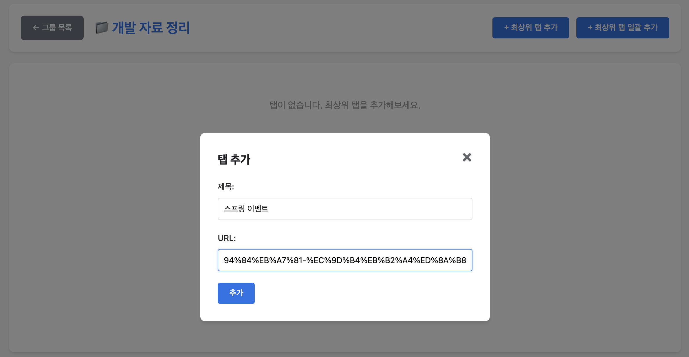
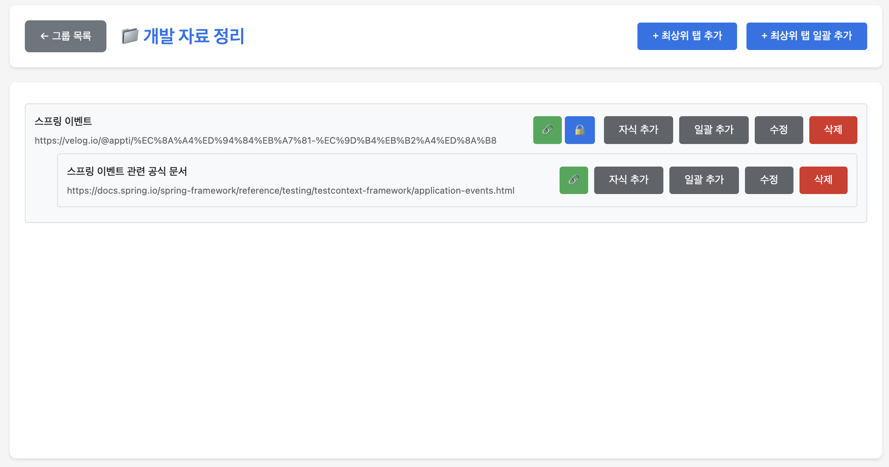
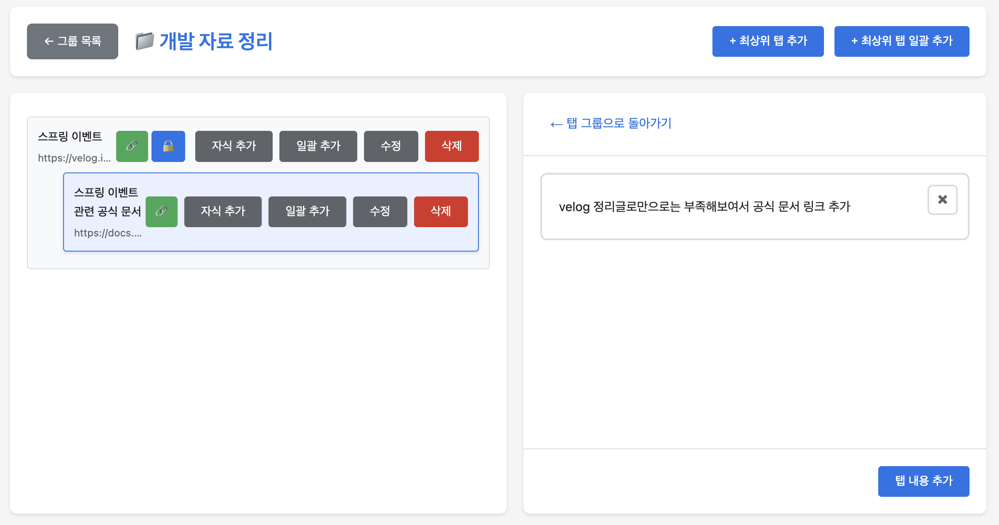

# 탭 관리 토이 프로젝트

## 설명 


- 복잡하게 띄운 탭을 계층형으로 편하게 관리하기 위한 토이 프로젝트입니다.
- 개인용으로 사용하기 위한 토이 프로젝트입니다.

## 시연




## 사용 방법 


- 메인 페이지인 `group.html`로 접근합니다.
- 카카오 아이디로 로그인을 진행합니다.


- 우측 상단의 새 그룹 추가를 통해 탭을 등록한 그룹을 추가합니다.



- 생성한 탭 그룹을 클릭하면 상세 페이지(`tabs.html`)로 이동합니다.



- 우측 상단의 최상위 탭 추가를 선택하고 제목, URL을 입력합니다.



- 탭의 자식 추가, 일괄 추가를 통해 하위 탭을 하나 이상 추가할 수 있습니다.
- 각 탭은 자유롭게 위치를 이동시킬 수 있습니다.



- 해당 탭을 클릭해 어떤 상황에서 탭을 추가했는지 메모할 수 있습니다.

## Closure Table
- RDB에서 탭의 계층형 구조를 표현하면서 탭의 부모-자식 관계 변경을 빠르게 적용하기 위해 Closure Table을 선택했습니다.

```text
[노드 테이블: 예시]
+-----+-----------+----------+-----------+---------------+------+----------+
| id  | writer_id | group_id | parent_id | title         | url  | position |
+-----+-----------+----------+-----------+---------------+------+----------+
| 101 | 1         | 10       | NULL      | 탭 2          | ...  | 0        |
| 102 | 1         | 10       | 101       | 탭 1          | ...  | 0        |
| 103 | 1         | 10       | 102       | 탭 1-2-1      | ...  | 0        |
| 104 | 1         | 10       | 102       | 탭 1-1        | ...  | 1        |
| 105 | 1         | 10       | 102       | 탭 1-2        | ...  | 2        |
| 106 | 1         | 10       | 102       | 탭 1-3        | ...  | 3        |
| 107 | 1         | 10       | NULL      | 탭 3          | ...  | 1        |
+-----+-----------+----------+-----------+---------------+------+----------+

[트리 변경 전]
탭 그룹 제목
├── (탭 1) [id=102, parent_id=NULL]
│ ├── (탭 1-2-1) [id=103, parent_id=102]
│ ├── (탭 1-1) [id=104, parent_id=102]
│ ├── (탭 1-2) [id=105, parent_id=102]
│ └── (탭 1-3) [id=106, parent_id=102]
├── (탭 2) [id=101, parent_id=NULL]
└── (탭 3) [id=107, parent_id=NULL]

+-----+-----------+-----------+
| id  | parent_id | title     |
+-----+-----------+-----------+
| 101 | NULL      | 탭 2      |
| 102 | NULL      | 탭 1      |
| 103 | 102       | 탭 1-2-1  |
| 104 | 102       | 탭 1-1    |
| 105 | 102       | 탭 1-2    |
| 106 | 102       | 탭 1-3    |
| 107 | NULL      | 탭 3      |
+-----+-----------+-----------+

+-------------+---------------+-------+------+---------------------------+
| ancestor_id | descendant_id | depth | self | 계층(경로)                
+-------------+---------------+-------+------+---------------------------+
| 101         | 101           | 0     | YES  | 101(탭2)                  
| 102         | 102           | 0     | YES  | 102(탭1)                  
| 102         | 103           | 1     | NO   | 102(탭1) → 103(탭1-2-1)   
| 102         | 104           | 1     | NO   | 102(탭1) → 104(탭1-1)     
| 102         | 105           | 1     | NO   | 102(탭1) → 105(탭1-2)     
| 102         | 106           | 1     | NO   | 102(탭1) → 106(탭1-3)     
| 103         | 103           | 0     | YES  | 103(탭1-2-1)              
| 104         | 104           | 0     | YES  | 104(탭1-1)                
| 105         | 105           | 0     | YES  | 105(탭1-2)                
| 106         | 106           | 0     | YES  | 106(탭1-3)                
| 107         | 107           | 0     | YES  | 107(탭3)                  
+-------------+---------------+-------+------+---------------------------+

[탭 1을 탭 2의 자식으로 변경 시]
탭 그룹 제목
├── (탭 2) [id=101, parent_id=NULL]
│ └── (탭 1) [id=102, parent_id=101]
│ ├── (탭 1-2-1) [id=103, parent_id=102]
│ ├── (탭 1-1) [id=104, parent_id=102]
│ ├── (탭 1-2) [id=105, parent_id=102]
│ └── (탭 1-3) [id=106, parent_id=102]
└── (탭 3) [id=107, parent_id=NULL]

+-----+-----------+-----------+
| id  | parent_id | title     |
+-----+-----------+-----------+
| 101 | NULL      | 탭 2      |
| 102 | 101       | 탭 1      |
| 103 | 102       | 탭 1-2-1  |
| 104 | 102       | 탭 1-1    |
| 105 | 102       | 탭 1-2    |
| 106 | 102       | 탭 1-3    |
| 107 | NULL      | 탭 3      |
+-----+-----------+-----------+

+-------------+---------------+-------+------+----------------------------------------+
| ancestor_id | descendant_id | depth | self | 계층(경로)                             
+-------------+---------------+-------+------+----------------------------------------+
| 101         | 101           | 0     | YES  | 101(탭2)                               
| 101         | 102           | 1     | NO   | 101(탭2) → 102(탭1)                    
| 101         | 103           | 2     | NO   | 101(탭2) → 102(탭1) → 103(탭1-2-1)     
| 101         | 104           | 2     | NO   | 101(탭2) → 102(탭1) → 104(탭1-1)       
| 101         | 105           | 2     | NO   | 101(탭2) → 102(탭1) → 105(탭1-2)       
| 101         | 106           | 2     | NO   | 101(탭2) → 102(탭1) → 106(탭1-3)       
| 102         | 102           | 0     | YES  | 102(탭1)                               
| 102         | 103           | 1     | NO   | 102(탭1) → 103(탭1-2-1)                
| 102         | 104           | 1     | NO   | 102(탭1) → 104(탭1-1)                  
| 102         | 105           | 1     | NO   | 102(탭1) → 105(탭1-2)                  
| 102         | 106           | 1     | NO   | 102(탭1) → 106(탭1-3)                  
| 103         | 103           | 0     | YES  | 103(탭1-2-1)                           
| 104         | 104           | 0     | YES  | 104(탭1-1)                             
| 105         | 105           | 0     | YES  | 105(탭1-2)                             
| 106         | 106           | 0     | YES  | 106(탭1-3)                             
| 107         | 107           | 0     | YES  | 107(탭3)                               
+-------------+---------------+-------+------+----------------------------------------+

```
